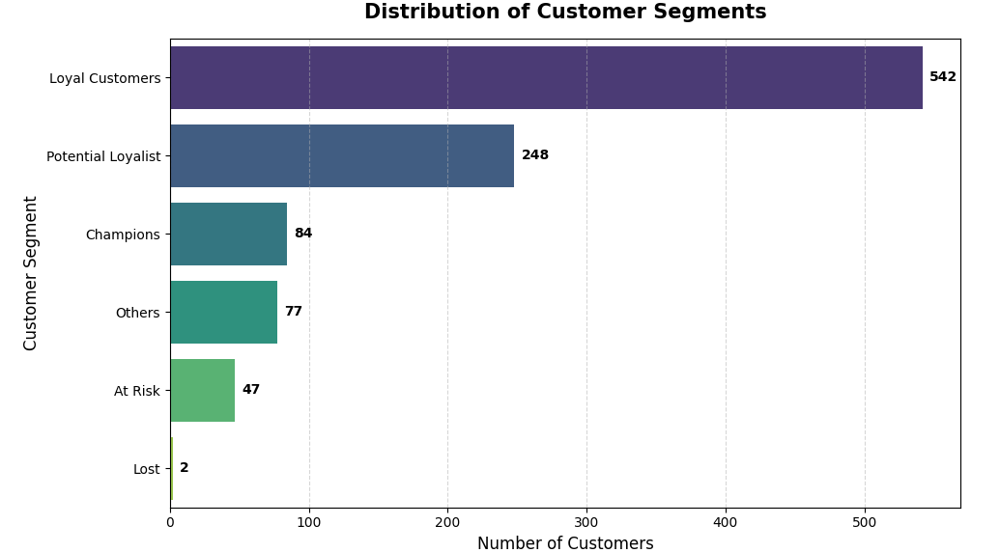
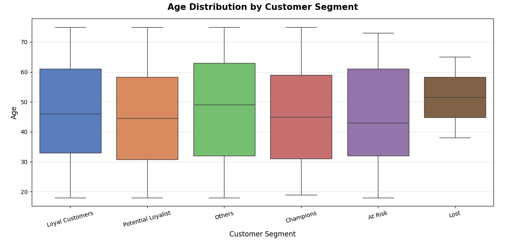
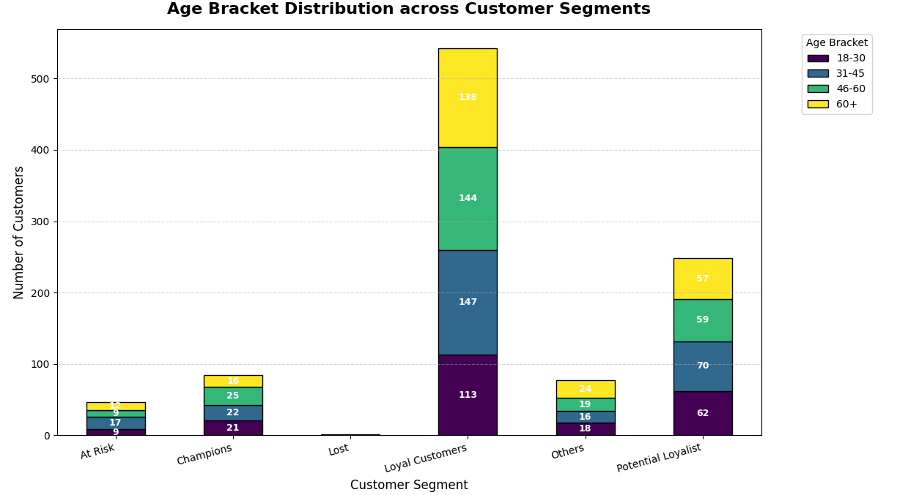
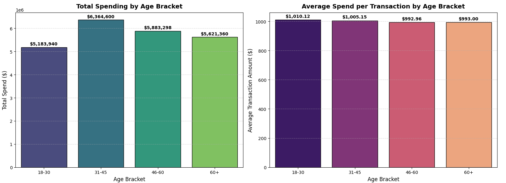
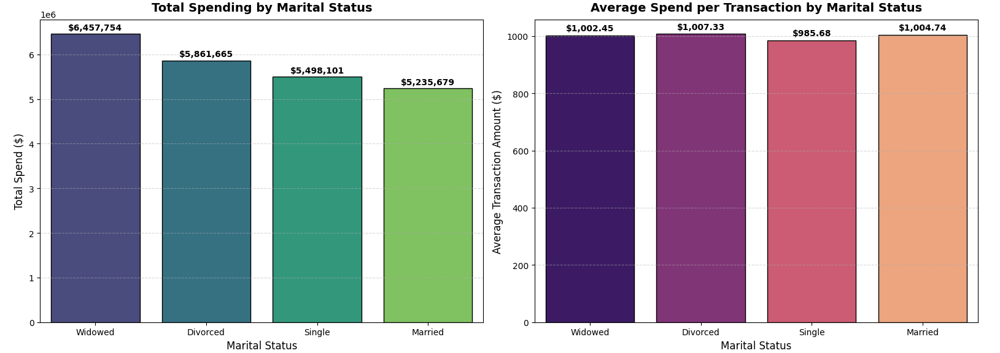

# Customer Segmentation using RFM Analysis

Segmenting 1,000 customers by **Recency, Frequency and Monetary** value, then profiling each segment by age and marital status to find where marketing effort should go.

**Tools:** Python · pandas · NumPy · Matplotlib · Seaborn · Jupyter / Google Colab

---

## Business Problem

Not all customers are equally valuable. Treating them the same wastes marketing budget. This project answers:

- Who are our best, most loyal customers?
- Which customers are slipping away and need re-engagement?
- Do age or marital status relate to how much customers spend?

## Dataset

| File | Rows | Description |
|------|------|-------------|
| `Customer_Master_Data.csv` | 1,000 | CustomerID, Name, Email, Gender, Age, City, MaritalStatus, NumChildren, JoinDate |
| `Customer_Transactions.csv` | 23,050 | CustomerID, TransactionDate, TransactionAmount |

Transactions span **2023 to mid-2025**. Gender is split almost evenly: Female 340, Male 332, Not Disclosed 328.

## Approach

1. **Load and inspect** both datasets (`info()`, `head()`, dtypes).
2. **Clean:** converted `JoinDate` and `TransactionDate` to datetime and validated that every transaction maps to a customer in the master table (0 orphan records removed).
3. **Merge** master data with transactions on `CustomerID`.
4. **Compute RFM metrics** per customer, using a reference date of **2025-07-30** (latest transaction + 1 day):
   - **Recency**: days since last transaction
   - **Frequency**: number of transactions
   - **Monetary**: total spend
5. **Score each metric from 1 to 5** with fixed business thresholds:

| Score | Recency (days) | Frequency (txns) | Monetary (spend) |
|:-----:|:--------------:|:----------------:|:----------------:|
| 5 | ≤ 30 | > 28 | > 40,000 |
| 4 | 31–60 | 22–28 | 30,001–40,000 |
| 3 | 61–120 | 15–21 | 20,001–30,000 |
| 2 | 121–240 | 8–14 | 10,001–20,000 |
| 1 | > 240 | ≤ 7 | ≤ 10,000 |

6. **Build a 3-digit RFM score** (e.g. `543`) and assign rule-based segments.
7. **Profile segments** by age brackets (18–30, 31–45, 46–60, 60+) and marital status.

### Segment Definitions

| Segment | Rule |
|---------|------|
| Champions | R 4–5, F 4–5, M 4–5 |
| Loyal Customers | F 4–5, R 2–5 |
| Potential Loyalist | R 4–5, F 2–3 |
| At Risk | R 1–2, F 3–5 |
| Lost | R 1, F 1–2, M 1–2 |
| Big Spenders | M 4–5, F 2–3, R 3–4 |
| Others | Everyone not matched above |

Rules are evaluated top to bottom, so a customer gets the first segment they match.

## Results

| Segment | Customers | Share |
|---------|----------:|------:|
| Loyal Customers | 542 | 54.2% |
| Potential Loyalist | 248 | 24.8% |
| Champions | 84 | 8.4% |
| Others | 77 | 7.7% |
| At Risk | 47 | 4.7% |
| Lost | 2 | 0.2% |

**Overall customer base:** median recency of 32 days, average of about 23 transactions and about 23,050 total spend per customer.

### Key Findings

- **Most customers are healthy.** About 79% fall into Loyal Customers or Potential Loyalists, so the base is engaged and recent.
- **Champions are rare (8.4%)** because very few customers reach a Monetary score of 4 or 5. Most sit in the 20,000–30,000 band.
- **At Risk is small (47 customers) but actionable.** These are previously frequent buyers who have gone quiet, and a win-back campaign is a good first target.
- **Age barely separates segments.** Mean age is about 45–48 in every segment.
- **Average spend per transaction is almost flat** across age brackets (about 993–1,010) and marital statuses (about 986–1,007). The ranking by *total* spend (e.g. Widowed highest, Married lowest) mostly reflects how many customers and transactions each group has, not richer purchases per transaction.

| Age Bracket | Total Spend | Avg per Transaction | Transactions |
|-------------|------------:|--------------------:|-------------:|
| 18–30 | 5,183,940 | 1,010.12 | 5,132 |
| 31–45 | 6,364,600 | 1,005.15 | 6,332 |
| 46–60 | 5,883,298 | 992.96 | 5,925 |
| 60+ | 5,621,360 | 993.00 | 5,661 |

### Recommended Actions

| Segment | Suggested action |
|---------|------------------|
| Champions | Loyalty rewards, early access, referral programme |
| Loyal Customers | Upsell and cross-sell to lift basket value |
| Potential Loyalist | Onboarding offers and nudges to build purchase frequency |
| At Risk | Personalised win-back offers before they churn |
| Lost | Low-cost reactivation email, otherwise deprioritise |

## Visualisations

## Visualisations

### 1. Customer Segment Distribution

  

### 2. Age Distribution by Segment

  

### 3. Age Brackets across Segments

  

### 4. Spending by Age Bracket

  

### 5. Spending by Marital Status

  

